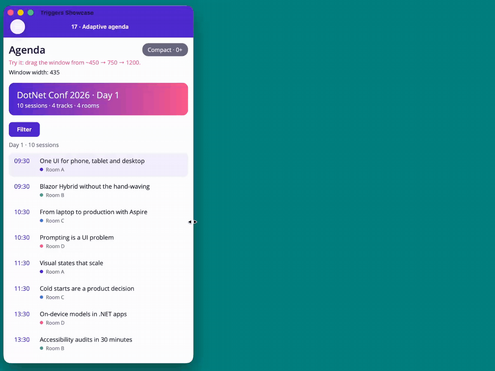
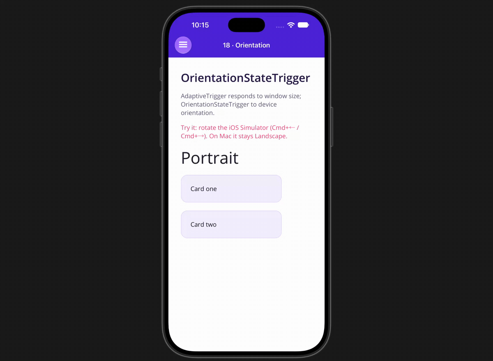

# maui-adaptive-ui-triggers

**One screen, every device.** A .NET MAUI 10 demo app for triggers, state triggers and the Visual State Manager: one page per trigger type, plus a conference agenda that reshapes itself for phone, tablet and desktop, all in XAML.

Companion code for the blog post and talk
**[One Screen, Every Device: State Triggers and the Visual State Manager in .NET MAUI](https://almirvuk.com/one-screen-every-device-state-triggers-and-the-visual-state-manager-in-net-maui/)**.



## Why

A page that looks right on a phone can break when the device rotates, the desktop window is resized, or the app runs on a tablet. Nothing crashes and nothing throws, but the app looks broken.

.NET MAUI has a declarative fix that lives in XAML. Triggers handle simple, state-based styling. State triggers drive the Visual State Manager, so one layout can adapt to window size, orientation and platform with little or no code-behind.

## What's inside

Each page is short and self-contained: open the XAML, find the trigger, run the page. The flyout numbers match the talk's slides.

**Part 1 · Triggers**

| Flyout entry | Shows | File |
|---|---|---|
| 06 · Property trigger | A trigger on a control's own property, inline and in an implicit Style | [PropertyTriggerPage.xaml](Pages/PropertyTriggerPage.xaml) |
| 08 · Data trigger | Disable Save while an Entry is empty, and why `Text=""` matters | [DataTriggerPage.xaml](Pages/DataTriggerPage.xaml) |
| 09 · Converter | "Greater than" with a converter, since triggers only test equality | [ConverterTriggerPage.xaml](Pages/ConverterTriggerPage.xaml), [IsGreaterThanConverter.cs](Converters/IsGreaterThanConverter.cs) |
| 10 · Event trigger | A `TriggerAction` that validates input (and has to undo itself) | [EventTriggerPage.xaml](Pages/EventTriggerPage.xaml), [NumericValidationTriggerAction.cs](TriggerActions/NumericValidationTriggerAction.cs) |
| 11 · Multi-trigger | Several conditions, all must be true | [MultiTriggerPage.xaml](Pages/MultiTriggerPage.xaml) |
| 12 · Enter / exit | Run an animation when a trigger starts and stops | [EnterExitActionsPage.xaml](Pages/EnterExitActionsPage.xaml), [FadeTriggerAction.cs](TriggerActions/FadeTriggerAction.cs) |

**Part 2 · State triggers**

| Flyout entry | Shows | File |
|---|---|---|
| 16 · StateTrigger | A visual state driven by a bound bool | [StateTriggerPage.xaml](Pages/StateTriggerPage.xaml) |
| 17 · AdaptiveTrigger | One breakpoint (800): cards stack or sit side by side | [AdaptiveTriggerPage.xaml](Pages/AdaptiveTriggerPage.xaml) |
| 17 · Adaptive agenda | A real layout with Compact (0+), Medium (600+) and Expanded (1000+) states, plus an independent height group | [AdaptiveAgendaPage.xaml](Pages/AdaptiveAgendaPage.xaml) |
| 18 · Orientation | Portrait and Landscape states | [OrientationTriggerPage.xaml](Pages/OrientationTriggerPage.xaml), [SceneOrientationStateTrigger.cs](StateTriggers/SceneOrientationStateTrigger.cs) |
| 19 · Device & Compare | `DeviceStateTrigger` per platform and `CompareStateTrigger` | [DeviceCompareTriggerPage.xaml](Pages/DeviceCompareTriggerPage.xaml) |

### The adaptive agenda

One `VisualStateGroup` on one root `Grid` drives the whole page. Every change to a child element is a `Setter` with `TargetName`:

- **Compact:** single column, compact rows, a Filter button.
- **Medium:** filter chips and a two-column card grid (the states swap `ItemTemplate` and `ItemsLayout`).
- **Expanded:** three panes (track sidebar, session list, detail pane), with the root Grid's `ColumnDefinitions` set by the state.

A second group keyed on window height shows or hides the hero banner at the same time.



## Trigger cheat sheet

| Type | Activates when | Reverts on its own? |
|---|---|---|
| `Trigger` | A control's own property has a value | Yes |
| `DataTrigger` | A bound value has a value | Yes |
| `MultiTrigger` | All conditions are true (no built-in OR) | Yes |
| `EventTrigger` | An event fires; runs a `TriggerAction`, no setters | **No** |
| Enter / exit actions | A trigger starts or stops; runs actions such as animations | n/a |
| `StateTrigger` | A bound bool (`IsActive`) is true | Yes |
| `AdaptiveTrigger` | The window is at least `MinWindowWidth` / `MinWindowHeight` | Yes |
| `OrientationStateTrigger` | The device is in Portrait or Landscape | Yes |
| `DeviceStateTrigger` | The app runs on a given platform (Mac Catalyst is its own) | Yes |
| `CompareStateTrigger` | A property equals a given value | Yes |

**Which state wins?** When several state triggers match, custom triggers come first, then the `AdaptiveTrigger` with the highest matching width, then height. So in the agenda at 1200 wide, all three width states match and Expanded wins.

## Gotchas

- **Null text in a `DataTrigger`:** a trigger on `Text.Length` never matches while `Text` is null. Initialize it with `Text=""`. The bug only shows on first load, so it slips through testing.
- **Event triggers don't undo:** write the undo into the action, or use a behavior.
- **Triggers in a `ResourceDictionary` are shared:** don't keep state in a shared custom trigger action.
- **Name-switched groups need a `Normal` state**, for example `CommonStates`.
- **`AdaptiveTrigger` in shared styles** misbehaves ([dotnet/maui#14259](https://github.com/dotnet/maui/issues/14259)). Attach the groups to one root layout and use `TargetName` setters.
- **Programmatic resizes may not fire `AdaptiveTrigger`** ([dotnet/maui#27646](https://github.com/dotnet/maui/issues/27646)). Test by resizing the real window.
- **`OrientationStateTrigger` stays on Portrait on iOS 27**, because it reads the deprecated status bar orientation. Page 18 uses [`SceneOrientationStateTrigger`](StateTriggers/SceneOrientationStateTrigger.cs), a drop-in that reads the window scene instead.
- **Unsubscribe** in custom actions, behaviors and state triggers that subscribe to events.
- **`Frame` is obsolete** since .NET 9. Use `Border`.

Rule of thumb: pick the simplest tool that fits (trigger, behavior, converter, then code), and move logic into code once the XAML needs a debugger to understand.

## Run it

Prerequisites:

- .NET 10 SDK with the MAUI workload: `dotnet workload install maui`
- For iOS and Mac Catalyst: macOS with Xcode and its iOS simulator runtimes

Mac Catalyst:

```bash
dotnet build -t:Run -f net10.0-maccatalyst
```

iOS simulator (use an **iPhone**, not an iPad):

```bash
# list simulators and copy an iPhone UDID
xcrun simctl list devices available | grep iPhone

dotnet build -t:Run -f net10.0-ios -p:_DeviceName=:v2:udid=<UDID>
```

Without `-p:_DeviceName=...` the default simulator is used. Then resize the Mac window, or rotate the simulator with Cmd+← / Cmd+→.

## Project layout

```
Pages/            one ContentPage per trigger type, plus the adaptive agenda
StateTriggers/    SceneOrientationStateTrigger (orientation workaround for iOS 27)
TriggerActions/   NumericValidationTriggerAction, FadeTriggerAction
Converters/       IsGreaterThanConverter, InverseBoolConverter, AreEqualConverter
Models/, Data/    the agenda's Session model and sample sessions
Resources/Styles/ Colors.xaml (palette), Styles.xaml (look only, no triggers)
AppShell.xaml     flyout: Part 1 · Triggers, Part 2 · State triggers
```

The presenter runbook for the talk is in [DEMO.md](DEMO.md).

## Learn more

- Blog post: [One Screen, Every Device: State Triggers and the Visual State Manager in .NET MAUI](https://almirvuk.com/one-screen-every-device-state-triggers-and-the-visual-state-manager-in-net-maui/)
- Docs: [Triggers](https://learn.microsoft.com/dotnet/maui/fundamentals/triggers?view=net-maui-10.0) · [Visual states](https://learn.microsoft.com/dotnet/maui/user-interface/visual-states?view=net-maui-10.0)
